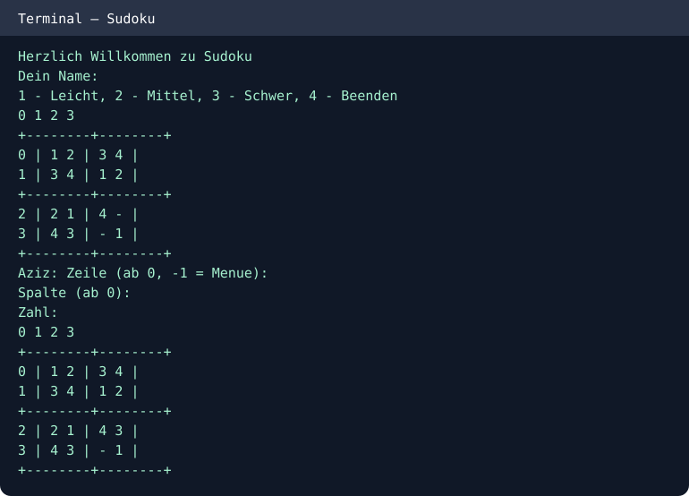

# Console Sudoku (Java)
A playable terminal Sudoku game with three levels: Easy (4×4), Medium (4×4), and Hard (9×9).

## Features
- Three difficulty options
- Locked pre-filled cells
- Row, column, and block validation
- Return to menu by entering -1 for the row

## Run
```bash
javac -d out src/*.java
java -cp out Spiel
```

Enter your name, difficulty (1–3), and row, column and value (zero-based row/column). Enter 4 to quit.

## Console demo
